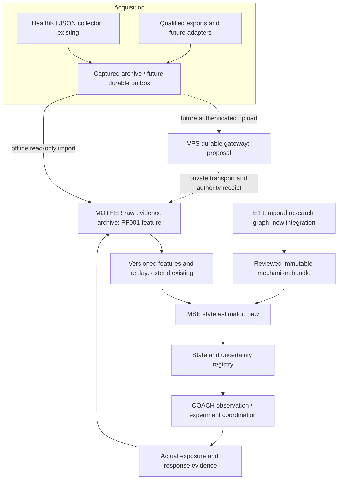
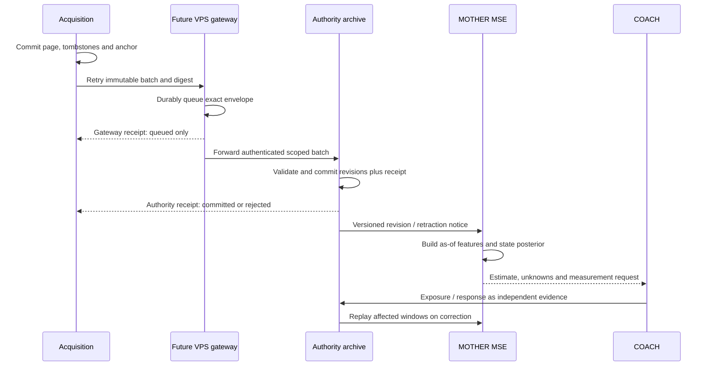

# MOTHER / COACH: Metabolic State Engine

## Repository-grounded architecture and first implementation

**Release:** MSE-001 v0.1.0  
**Audit date:** 13 November 2026, Pacific/Guam  
**Disposition:** isolated offline research prototype; no production deployment  
**Scientific scope:** physiological state estimation, mechanistic hypotheses, measurement selection, and prospective individual experimentation

The recommended architecture is an additive inference layer downstream of the existing physiological evidence archive. Preserve the working HealthKit JSON collector and its ongoing SQLite qualification. Reuse MOTHER's PF001 source revisions, timestamps, epistemic labels and replay controls. Keep the evolving E1 research graph separate from the inference runtime, connected by reviewed, immutable mechanism bundles.

The first executable slice estimates deviations in observed heart rate and vendor-derived SDNN. It does not estimate insulin resistance, mitochondrial function, inflammation, sympathetic fractions or microbial flux. Glucose can enter the next slice through a qualified archive/export adapter. Meal, activity and sleep context must be recorded explicitly; the active Swift collector does not currently acquire those inputs.

### How to read this report

**Inspected** means source was read at a pinned commit. **Reported** means a repository report or prior user observation describes a result. **Executed here** means a check ran in this isolated workspace. **Proposed** means a new design. None of those labels alone establishes production deployment or scientific validity. Source references R01-R12 and scientific references S01-S21 appear at the end. Supporting audits retain detailed file locations and historical qualification boundaries.

The report follows deliverables A-I. The accompanying bundle includes the full supporting audits, machine-readable design contracts, an additive schema proposal, synthetic examples, the offline prototype, release notes and verification records. No real physiological records are included.

# A. Repository audit

## A1. Inspected repositories and branches

| Repository / branch | Pinned commit | What the reference contains |
|---|---|---|
| mother-health-bridge / main | 32aa85ef756186c64e7b747780d522e2e65156d3 | v0.3 JSON HealthKit collector and basic UI |
| mother-health-bridge / feature/sqlite-v0.4 | b2baa2e6bd2d018b6e34a07c783b7c3523366374 | Migration, diagnostics, reconciliation, candidate repository and synthetic authority work |
| mother-health-bridge / feature/mother-glucose-read-v1 | e84a848796689b9bcb247a57024bc9f8d6e576c1 | Authenticated glucose read/display client; draft PR 1 |
| mother / main | e4510efbb05f711f7fdc47fbab0fd6c19e8324fd | Legacy application API and heuristic prediction stub |
| mother / work/physiology-foundation-pf001 | 5a6f71a45dc64880bc06a0e1a50c7d05ff119cba | Physiological evidence archive, imports, replay and evaluation |
| mother / work/i01-delivery-state-readonly | 81c3fcceadcf5bf7462bf813427b98e4f87721e0 | PF001 descendant with offline event/receipt reconciliation |
| mother / work/r02-source-qualification-01 | 03e422075d584ff5de92578bacb4749f94412f4c | Separate source-qualification increment |
| coach / main | 1dd63725dbed112fc33d9c9a64b60b1d7263c246 | Existing reminder/prediction coordination |
| coach / work/i01-delivery-status-view | 184606fe9d5022997f09a2e4d6ef38e5dca4a9bc | Offline factual capture and delivery-status work |

These are separate source lines, not an already unified release. The glucose branch incorporated SQLite base 9c89bea, before the later 996690e/b2baa2e incremental-authority changes. Package.swift and docs/CHANGELOG.md require integration that retains both additions. The primary bridge branch was captured as 84 text files and each original Git blob SHA was verified. The snapshot is a source capture, not a claim that the user's Mac working tree was inspected. [R01-R07]

Relevant recent bridge commits are b5c005d (inactive incremental repository), 996690e (synthetic collector authority integration), b2baa2e (its report), and 57ddb59/3fa98ab/e84a848 (glucose implementation, base integration and verification). Main remains separate. No branches, tags or production refs were changed by this assignment.

## A2. The actual acquisition path

`MotherHealthBridge/ContentView.swift` contains `HealthCollector`. It requests `.heartRate` and `.heartRateVariabilitySDNN`, creates independent anchored queries, and writes Application Support `mother-health-v03.json`. A newly created `HealthArchive` starts its historical predicate seven days before creation; that start is subsequently persisted. Queries use `HKObjectQueryNoLimit` and a long-running update handler. The app starts collection while active and stops it in the background. Background delivery and complete historical acquisition are not established by this path. [R01]

`MotherHealthBridge/HealthArchive.swift` defines the actual archive:

| Existing object | Actual fields |
|---|---|
| SavedReading | id: UUID; kind; value: Double; unit; start/end: Date; source; bundleID; receivedAt; optional deletedAt |
| HealthArchive | readings; anchors keyed by channel with opaque Data bytes; tombstones keyed by UUID; backfillStart |

The collector copies the archive, handles added/deleted UUIDs, stores the returned anchor in that same copy, atomically writes it, then updates its in-memory view. Same-callback deletion wins. A write failure leaves the prior archive selected and stops the affected query. Stopped-query identity is checked before accepting callbacks. These are important reusable durability properties.

Existing UUIDs are skipped rather than compared for conflicting fields in the active collector. Repeated deletion callbacks can update the tombstone's local receipt time while the reading retains its first deletedAt. Neither time is a proven source deletion occurrence time. Unknown deleted UUIDs have no channel in the JSON tombstone dictionary. The newer diagnostic adapter rejects conflicting repeated sample contents, but that implementation is not the active JSON collector.

The archive preserves useful normalized records, not every original HealthKit field. Device hardware, full source revision/version, firmware, HealthKit metadata, original timestamp spelling/offset, calibration and acquisition conditions are absent. Their downstream values must remain unknown. The source application name cannot establish that the sensor was an Apple Watch or Polar H10. HealthKit SDNN is a received vendor-derived quantity; Level 1 does not imply access to its underlying RR intervals. [R01; S01]

Apple documents anchors as opaque positions over added/deleted objects. It also documents that denied read permission can look like no accessible data and that deleted-object records are temporary. Therefore an empty page, successful authorization request or bounded diagnostic run cannot establish full permission, lifetime history or deletion completeness. A future background-observer implementation needs its own qualification. [S02-S04]

## A3. Four distinct storage roles

| Existing file | Actual store/schema | Status |
|---|---|---|
| HealthSQLiteStore.swift | mother-health-v04.sqlite; readings, tombstones, anchors, settings, migration_manifest; user_version 1 | Migration snapshot, not active acquisition |
| SQLiteHealthKitAdapter.swift | mother-health-acquisition-v04.sqlite; acquisition_readings, acquisition_tombstones, acquisition_progress, acquisition_cursors | Explicitly enabled diagnostic store |
| CandidateArchiveBuilder.swift | observations, reading_provenance, tombstones, deletion_provenance, anchor_provenance, sources, verification_metadata, future_cursors, checkpoint | Preserved historical candidate with identity/payload rows |
| IncrementalCandidateRepository.swift | Schema-v2 candidate copy with canonical acquisition rows, receipts and repository_state | macOS-only, temporary-directory-only synthetic implementation |

The migration takes a writer transaction, preserves original JSON and a unique non-overwriting snapshot, hashes it, verifies field-level content and exact anchor bytes, and commits records/settings/manifest together. A repeat verifies the captured snapshot, not whatever the live JSON contains later. That distinction explains why dashboard counts at another time are not a migration equivalence check.

`HealthAcquisitionRepository.swift` already provides `beginQuery`, `apply`, `committedAnchor`, `progress` and `isRetryable`. Successful apply means the complete page and cursor are committed. `HealthKitQueryDriver.swift`, `OneShotHealthKitSource.swift` and `AcquisitionCoordinator.swift` build on this seam with one-shot query identity, committed-anchor retry and bounded pages. They must not be attached to a streaming updateHandler by treating one-shot tokens as reusable callbacks.

The schema-v2 repository preserves historical candidate observations and maintains a separate acquired canonical union. A future exporter must read `acquisition_readings` plus effective deletions and receipts; reading only historical `observations` would omit later acquisitions. Its synthetic authority journal, fences and file locks are valuable design work, but they do not activate an iPhone backend. [R02-R03]

## A4. Glucose, communication and related MOTHER/COACH code

The glucose feature's `MotherGlucose.swift` implements HTTPS GET at `/v1/physiology/glucose/latest`, `/observations` and `/coverage`. It retains decimal strings, original units, measurement/source-arrival/ingestion times, native identity/revision and quality flags. Its current validation is specific to Nightscout interstitial glucose in mg/dL. `MotherGlucoseCache` validates half-open windows, cursor/snapshot consistency, unique ordered records and complete-page publication. It uses session-only memory, rejects redirects and purges on authorization failure or identity invalidation. It is a read/display integration, not an iPhone upload pipeline. Coverage is a separately requested projection and need not be the exact same transaction as the observation snapshot. [R04]

The N3 server pin `59a6ce9c0a4fb303e13302ed38deaaacdded277d` appears in project reports and production-framework issues 42/50. It did not resolve in the checked MOTHER or production-framework repositories. No local server source was found. Thus the server schema, deployment and reported NAS/staging results could not be independently inspected here. Its existence on another checkout remains possible. This is a precise access boundary, not a claim that the user's server is absent. [R05]

MOTHER's PF001 branch already defines `source_revision`, `observation`, `stream`, `session`, `event` and `import_run` in `mother/physiology/schemas/v1.schema.json`. Its SQLite migration creates raw_artifacts, source_revisions, normalized_records, source_heads, run_revisions, import_runs and checkpoints. Original bytes and canonical revision hashes are distinct. Source heads support corrected or reverted current projections while retaining prior revisions. Application code enforces immutability; the inspected schema does not protect against arbitrary privileged SQL writes. [R06]

The existing Apple XML, TCX, spot CSV and qualified Nightscout readers are reusable import boundaries. TCX HR is not beat-to-beat H10 integration; CSV BP is not an Omron Bluetooth adapter. Accepted channel names do not prove actual device availability. There is no inspected working CPAP, raw ECG/RR, microbiome or broad mechanistic laboratory acquisition pipeline. [R06-R08]

COACH's manual events preserve question/answer, recommendation/acknowledgment, reported action and outcome distinctions. MOTHER validates their links and archives original bytes. Local content-addressed outbox envelopes, durable receipt recovery and read-only delivery reconciliation exist on I01 descendants. Hashes establish content integrity, not sender identity. Authenticated physiological network batch ingestion was not established in these inspected branches. [R07]

## A5. Tests, analysis and deployment boundaries

The latest bridge report records 194 Swift test functions / 374 cases for the SQLite authority work. The glucose draft records 190 functions / 353 executed cases, with live staging separately skipped. Those are historical reported runs; Swift/Xcode are unavailable here, so they were not rerun. Repository documentation records user-reported HR 700/7 pages and SDNN 600/6 pages, plus later four-store reconciliation with verified migration snapshot, zero shared-field conflicts and no unstable/unreadable warning. Exact UUID-set equivalence, complete history, physical interrupted-write recovery and the earlier four-reading discrepancy remain unresolved. [R03-R04; R09]

MOTHER's existing evaluation code supplies a chronological, leakage-controlled scalar median baseline and preserves unknown outcomes. Its empirical range is explicitly uncalibrated. The source-matched PF001 evaluation and independent leakage tests were rerun here: **35 passed**. That establishes bounded software behavior, not individual prediction performance. The supporting audit records an initial missing-pytest environment failure and the successful run in the existing isolated release environment. [R08]

Legacy MOTHER `/api/models/predict` returns `stub-0.0.1` heuristics and fixed energy windows. Its root Dockerfile copies `mother_app`, not `mother/physiology`; adding a module elsewhere would not deploy it through that image. Multiple FastAPI launch families exist, and main's CI masks some failures with `|| true`. Endpoint ownership, packaging and authoritative deployment must be reconciled before service integration. [R10]

**Existence conclusion:** HealthKit acquisition and durable local JSON exist; diagnostic SQLite and substantial MOTHER archive/replay/offline receipt components exist on feature branches. The proposed complete sensors-to-VPS-to-authoritative-store-to-MSE-to-COACH loop is not verified as one deployed system.

# B. Proposed system architecture

## B1. Boundaries and component diagram

Keep acquisition, durable evidence, inference, scientific knowledge and coordination as separate responsibilities. Deploy the first MSE as an offline Python package or scheduled local process after explicit deployment approval; a separate always-on service is unnecessary initially.

The evidence archive owns source truth. MSE has read access to explicit evidence snapshots and write access only to its derived store. COACH consumes state explanations and measurement requests; it records assignments, actions and responses independently. The research graph can change without changing a running model's interpretation: the model pins an approved bundle hash. No model reads arbitrary graph edits or turns literature text into executable dosing.

## B2. Data-flow and acknowledgment boundaries

This is the proposed transport sequence, not an implementation claim. Phone acquisition durability must not depend on network reachability. A gateway `202 queued` is not proof of authoritative ingestion. Repeated identical batches must return the same commitment identity; the same key with different bytes is a conflict. A receiver crash after commit but before response must recover the existing receipt. Buffer retirement requires an authoritative receipt and an explicit retention policy, never a timeout or an unauthenticated copied status report.

## B3. Proposed interfaces

| Boundary | Contract / API proposal | Required semantics |
|---|---|---|
| Bridge to normalizer | Captured JSON bytes plus subject/source namespace and artifact SHA | Explicit Swift epoch conversion; UUID/tombstones retained; absent provenance unknown |
| Future upload | POST /v1/physiology/batches | Server-bound subject/source grant; bounded payload; idempotency key and body hash; quarantine/reject details |
| Archive to MSE | physiology.revision_committed.v1 | Snapshot ID; revision IDs; availability watermark; correction/deletion links |
| MSE to COACH | mse.state_estimated.v1 | as_of, validity, model/run/bundle hashes, posterior and unknown reasons, supporting lineage |
| MOTHER measurement planning | mse.measurement_requested.v1 | Competing hypotheses, discriminating observation, timing, feasibility and stop/unknown rule |
| COACH evidence return | Existing event envelope with versioned extension | Assignment, reported/observed exposure and response remain separate |
| Optional future reads | GET /v1/mse/states and /measurement-requests | Subject-scoped read authorization; immutable snapshot paging; no treatment-write capability |

The existing glucose routes are retained. Future route names must be reconciled with the unavailable N3 server before implementation. PF001 v1 is not silently changed to accept a new `state_estimate` record kind; MSE objects have a separate contract version and namespace.

## B4. Storage, clocks, quality and security

Reuse the PF001 SQLite archive on a qualified local filesystem. Add a separate MSE SQLite database for small individual-scale inference; Parquet remains a regenerable analytical view. Keep large future ECG/RR or CPAP waveforms in content-addressed artifact files with interval indexes, not one giant JSON database row. Do not introduce Kafka, Kubernetes, Neo4j, TimescaleDB or a new PostgreSQL service before a concrete throughput/query requirement justifies it. SQLite WAL has same-host shared-memory requirements; a NAS's locally mounted ZFS dataset and an NFS-mounted database file are different deployment cases. [S05]

Canonical records retain original value/unit and timestamp bytes where available, plus normalized numeric values, a declared unit conversion version, timezone/offset, precision and clock error. Use actual event time for physiology and actual knowledge/ingestion time for online eligibility. Swift default Date JSON uses seconds relative to 2001-01-01; SQLite migration times use Unix seconds. Do not guess either epoch from number size. Preserve sensor clock-to-host mappings for future streams. Half-open windows [start,end) prevent duplicate boundary counts.

Quarantine malformed data; flag physiologically unusual but structurally valid values without silently erasing them. Preserve sensor disagreements and explicitly link relayed copies so HealthKit and a direct feed of the same reading are not counted as independent evidence. Store coverage, calibration, measurement method, invalidity reasons, imputation method and algorithm version. A sparse SDNN series never becomes a dense RR signal.

Use distinct OS identities and grants for ingestion, inference, COACH and research curation. Bind subject and source scope on the server rather than trusting submitted IDs. Retain TLS verification, prohibit bearer forwarding across redirects, bound requests and avoid physiological payloads in logs. The VPS should hold only the minimum encrypted durable queue needed for relay; the authoritative archive and mechanism/run histories remain under the user's control on qualified local storage. No credential changes are part of this release. Research graph imports are untrusted data, never executed code.

# C. Metabolic-state model specification

## C1. Four levels and state promotion

| Level | Meaning | Example | Prohibited inference shortcut |
|---|---|---|---|
| L1 received observations | Instrument output or report with measurement/provenance semantics | HR, vendor-derived SDNN, interstitial glucose, reported meal | Treating a vendor metric as raw ECG or a report as verified exposure |
| L2 features | Reproducible transforms over eligible observations | Historical baseline, change, variance, event response, cross-lag summary | Future leakage, filling gaps as measurements, mixing SDNN/RMSSD |
| L3 latent states | Model-defined unobserved quantities with uncertainty/observability | Smoothed HR residual, context-dependent glucose deviation | Renaming a residual as insulin resistance or inflammation |
| L4 mechanisms | Scoped causal knowledge and competing hypotheses | Transport, enzyme/receptor action, microbial exchange | Assuming a known pathway is active in this individual |

An L3 state requires an operational definition, units, observation model, prior, supporting channels, uncertainty type and explicit nonidentifiability conditions. Mechanistic names are promoted only with independent discriminating observations. The first runnable model estimates signal deviations; broader metabolic dimensions remain present in the registry with `unknown` values.

| Candidate dimension | Earliest useful evidence | Current publication boundary |
|---|---|---|
| Glycemic dynamics | Qualified CGM plus event timing and quality | Interstitial trajectory/response; gut appearance, hepatic output and insulin action unresolved |
| Fuel availability / oxidation | Glucose/ketones/lactate, diet and workload; later valid gas exchange or tracers | Concentration is not production/oxidation flux |
| Autonomic context / recovery | HR, exact HRV metric, posture/respiration/activity | HR/SDNN deviation now; specific sympathetic/vagal allocation unknown |
| Cardiopulmonary workload | Activity plus HR, BP, respiratory data/SpO2 | Source-conditioned workload proxy; no direct tissue ATP or mitochondrial inference |
| Hydration / thermal state | Conditions, intake/loss, weight, core/skin temperature and appropriate labs | Skin temperature is not core temperature; absent hydration evidence stays unknown |
| Sleep / circadian / demand | Vendor sleep, light/activity/time, repeated baseline | Circadian-context model after qualified inputs; stage labels retain vendor status |
| Immune / inflammatory | Temporally relevant measured labs and context | Contextual biomarker state; no cytokine inference from low SDNN |
| Gut / microbial influence | Substrates, strain/function data, compartment metabolites and transit | Capability/hypotheses; flux and receptor engagement require additional evidence |

## C2. Compare candidate methods

| Approach | Strength | Limitation / decision |
|---|---|---|
| Historical median / circadian regression | Transparent, low data requirement, strong baseline | Mandatory comparator; not a mechanistic state model |
| Small continuous-time Bayesian state-space model | Irregular updates, latent memory, uncertainty and individualized parameters | Recommended core; keep dimensions identifiable and priors visible |
| Switching state-space model | Can represent sleep/activity/recovery regimes and hysteresis | Later; sparse data can make inferred regimes arbitrary |
| Mechanistic compartment ODE with Bayesian parameters | Conservation and interpretable rates | Add narrowly when independent inputs identify parameters |
| Causal graphical/time-series model | Explicit intervention targets and confounding assumptions | Needed for causal analysis; predictive dependence alone does not orient edges |
| Dynamic FBA / community metabolic model | Carbon/electron/flux feasibility and ecological hypotheses | Offline research module, not a live universal metabolism estimator |
| Large end-to-end neural model | Flexible prediction with rich data | Defer until it beats simple baselines and retains calibrated uncertainty/explanations |

## C3. General dynamic formulation

For individual i, latent state x, recorded exposure u and context c:

$$dx_i(t)=f_{\theta_i}(x_i(t),u_i(t),c_i(t),m)dt+L_i dW(t).$$

For modality j observed at its own timestamp, with uncertain delay delta, device bias b and measurement error epsilon:

$$y_{j,k}=h_j(x_i(t_{j,k}-\delta_j),c_i(t_{j,k}),d_j)+b_{j,d_j}+\epsilon_{j,k}.$$

An interval aggregate uses an explicitly declared integral/summary over its acquisition window, not an arbitrary point assignment. m is an immutable mechanism-profile version. For linear dynamics, F(delta_t)=exp(A delta_t) and Q(delta_t) is the integral of exp(As) L L-transpose exp(A-transpose s) over elapsed time. Only measurement rows actually observed update the posterior. Missing channels propagate prior uncertainty rather than creating pseudo-observations.

Separate online filtering from retrospective smoothing. A smoother can use later evidence to reconstruct a past state, but its product must be labeled retrospective and cannot be used to claim a forecast was available then. Late records create a new run/revision of affected windows; earlier published runs remain reproducible.

## C4. Executable reference model

The prototype uses independent scalar Ornstein-Uhlenbeck residual filters for each subject, source, channel, device/application, measurement method, exact observed interval duration, optional declared acquisition-window duration, calibration identity and explicit context label. It uses HR directly and log(SDNN) for positive SDNN. Its prior-only reference baseline is a simple historical estimate; it does not yet implement the full harmonic/context regression or robust observation model proposed below.

$$r_k=g(y_k)-\hat b_{k^-},\quad a_k=e^{-\Delta t/\tau}.$$

$$\mu_k^-=a_k\mu_{k-1},\quad P_k^-=a_k^2P_{k-1}+q_\infty(1-a_k^2).$$

$$K_k=P_k^-/(P_k^-+R_k+V_{b,k}),\quad \mu_k=\mu_k^-+K_k(r_k-\mu_k^-).$$

$$P_k=(1-K_k)P_k^-.$$

Here R is assumed measurement variance and Vb represents baseline uncertainty under the reference calculation. These parameters are explicit configuration, not calibrated personal physiological constants. The model assumes Gaussian errors and conditionally independent channels. Its nominal intervals are conditional on those assumptions; true biological coverage has not been established. Baseline reuse and temporal dependence need stronger treatment before claiming calibrated uncertainty.

Too few prior observations yield `status: unknown` and reason `insufficient_prior_baseline`, not an estimate with a fabricated baseline. Long gaps reset the short-term residual memory and mark freshness. Source/device changes require separate strata or an explicit bridge calibration. Unknown context stays unknown; it is not relabeled resting. The model has no conversion from residuals to endocrine or immune states.

The executable release is explicitly retrospective. Aggregate observations are indexed at interval end, and baseline eligibility requires completed nonoverlapping earlier intervals. A global source-receipt cutoff selects a historical evidence snapshot; it does not reconstruct every earlier decision's available evidence, and the output marks historical availability as unestablished. Strict authoritative online/as-available inference remains a later adapter/replay capability. Known invalid observations are excluded from baseline/filter support, and retained dependency quality flags must propagate into state explanations. Independent review found the interval/method/quality boundary risks and prompted targeted corrections before final packaging.

## C5. Individual learning and observability

After the reference implementation, fit a context baseline with individual intercept, source/method strata, harmonic time-of-day terms, documented activity/posture and pre-event covariates. Learn meal/exercise/sleep response kernels with distributed lags from repeated episodes. Estimate within-person variation separately from between-person priors. Use hierarchical partial pooling only when the population provenance and applicability are explicit.

Keep a frozen accepted baseline and a slowly adapting candidate. A change-point detector should mark sustained departures, device changes or new regimes; it must not immediately absorb illness or an unusual prolonged response into a new normal. Preserve elapsed-time memory, carryover and adaptation. At first, compare explicit previous-state and exposure-history features; add switching modes only when repeated data justify them.

For a local linear model, compute the observability matrix/Gramian using the actual sensor schedule and inspect rank and conditioning. For nonlinear parameters, use sensitivity analysis, profile likelihood, posterior correlations and recovery tests under plausible sensor schedules. Strong priors can produce a narrow posterior for an unobservable parameter; label it prior-dominated rather than identified. Profile likelihood is one established tool for separating structural and practical nonidentifiability. [S06]

Recommended statuses are `not_measured`, `insufficient_coverage`, `artifact_suspected`, `context_unknown`, `out_of_domain`, `non_identifiable`, `prior_dominated` and `inferred_model_conditional`. Keep the numeric uncertainty interval separate from this status and from uncertainty over competing mechanisms.

For glucose, the mass balance is:

$$V_G\dot G=R_{a,meal}+EGP-R_d-U_{renal}.$$

Even perfect glucose observations constrain only the net balance. Adding the same arbitrary function to EGP and Rd leaves G unchanged. Meal appearance and disposal can also compensate. Sparse HR/SDNN does not resolve that symmetry. The original minimal-model work used measured insulin input under controlled conditions; CGM alone does not recreate that experiment. A possible interstitial observation compartment is tau_G times dG_ISF/dt = G_plasma - G_ISF, with additional device filtering/bias. A published fasting transport-lag estimate does not justify a universal shift for meals/exercise or identify an individual's lag from CGM alone. [S07-S08]

## C6. Active measurement

MOTHER emits a request containing the unresolved hypotheses, supporting records, predictions that differ, proposed observation/conditions/time, required capability, burden, exclusions and an explicit unknown result if the measurement cannot discriminate. COACH coordinates that observation and returns its actual provenance.

Start with an auditable rule table: higher HR/lower SDNN with unknown activity calls for activity/posture and respiration context; a suspicious CGM trace calls for device-quality review and, where already appropriate/available, an independent glucose observation; repeat matched episodes test reproducibility but do not identify hepatic output. No new medical test is automatically ordered.

For specified candidate models, later optimize expected information gain:

$$U(d)=E_y[KL(p(H,\theta\mid D,y,d)\Vert p(H,\theta\mid D))]-\lambda C(d).$$

The utility is relative to the candidate model family and its calibration. Include `other/unmodeled`; do not invent hypothesis probabilities or information-gain numbers for an informal explanation list. Respiratory modulation of HRV illustrates why collecting a discriminating covariate can be more informative than collecting more of the same scalar. [S09-S10]

# D. Mechanistic map integration

## D1. E1 and graph structure

E1 remains the project's fixed working premise: industrialization-associated ecological changes may remove coevolved microbial biochemical support and create host-environment mismatch. Store it as a versioned research premise, with rationale and scope. It is not assigned an evidence grade pretending it is a universal established conclusion. Individual downstream claims remain independently testable and revisable.

Use a multilayer temporal claim graph implemented initially with relational tables and reified mechanism nodes. This gives hypergraph semantics without requiring a specialized graph database. A reaction or ecological event can have several substrates, catalysts and prerequisites jointly; an ordinary binary positive edge would lose that conjunction.

| Proposed entity | Required information |
|---|---|
| node / node_revision | Stable local CURIE, type, definition, external identifiers and version, compartment/species/strain/tissue |
| mechanism_claim / claim_revision | Stable claim ID, version, scoped assertion, direction/effect, temporal applicability, status and supersession |
| claim_participant | Claim, node, role, stoichiometric coefficient, unit and compartment |
| condition | Typed AND/OR predicate tree; explicit unknown semantics; physiological/environmental bounds |
| evidence_record / evidence_link | DOI/PMID/accession, experiment/figure location, design, assay/species/context, grade, support/contradiction/null relation |
| parameter | Name, dimensions, value/distribution or unknown, assay conditions and evidence |
| mechanism_snapshot | Reviewed claim revisions, parameter set, compiler version, content hash and allowed inference uses |

Use verified identifiers in appropriate namespaces: ChEBI for chemicals, Rhea for reactions, UniProt/HGNC for proteins/genes, EC for enzyme classes, Reactome for pathways, NCBI Taxonomy plus assembly/strain identifiers, GO/CL/UBERON for function/cells/anatomy, and DOI/PMID for evidence. Do not use an EC number as a unique strain enzyme identity or silently equate an obsolete synonym with a current term. Local stable IDs retain identity across renames; revisions and xrefs carry change history.

Time has two axes: biological valid time and knowledge/revision time. Do not overwrite a previously supported claim when contradictory evidence arrives. Link both records, change the current assessment and preserve the old inference bundle. The mechanistic graph describes biological possibilities and scoped causal evidence, not every individual's current state.

## D2. Conditional ecology and biochemical constraints

Represent dietary and host-derived substrates, organism/strain biomass, gene capability, expression/enzyme activity, metabolite pools, transport and host responses separately. Competition, cross-feeding, cooperation, predation/phage infection and lysis use typed participant roles and time/space conditions. Gene abundance is not enzyme flux; metabolite abundance is not production rate.

For concentrations c and reaction fluxes v:

$$\dot c=S v+T(c,c_{neighbor})+inputs-outputs-washout.$$

Use elemental, charge and electron balance with explicit exchanges. Include pH, redox potential, temperature, oxygen, transit, spatial compartment and cofactor availability. At appropriate quasi-steady subsystems Sv=0 may constrain flux; the whole ecological system need not be at steady state. DeltaG = DeltaG0-prime + RT ln Q requires appropriate activities, biochemical standard state and compartment conditions. Thermodynamic possibility is not proof of physiological flux. Offline dynamic/community FBA can generate testable bounds, with objective/tradeoff sensitivity retained. [S11]

Two useful primary-source motifs are substrate/pH/strain-dependent cross-feeding demonstrated in anaerobic cultures, and mouse colonocyte-microbe feedback in which epithelial PPAR-gamma loss alone did not produce the studied oxygenation effect without inflammatory context. Encode joint conditions and species/assay scope; keep oxygen and nitrate routes distinct. Neither motif permits inferring the pathway from a person's HRV. [S12-S13]

Conditions use three-valued logic. A prerequisite with missing pH or unknown receptor expression is `unknown`, not true. For eligibility decisions, unknown required conditions block a positive recommendation. For simulation they become explicit uncertain scenario parameters. A safe typed predicate interpreter handles approved operators; arbitrary Python, SQL or natural-language execution is excluded.

## D3. Receptors as dynamic state

Keep ligand provenance/compartment concentration, free concentration, receptor surface abundance, binding/occupancy, pathway-specific activation, downstream function and ecological feedback as different variables. Store affinity under its assay, ligand competition, agonism/antagonism/partial efficacy and bias. Expression at RNA level is not a direct measurement of surface receptor number. EC50 is not automatically Kd. [S14]

For one shared competitive equilibrium site, an illustrative template is:

$$\theta_j=(L_j/K_j)/(1+\sum_k L_k/K_k),\quad S_p=\mathcal{G}_p(R_s\sum_j\epsilon_{jp}\theta_j,c).$$

The model assumes the relevant free concentrations, equilibrium and the specified binding mechanism. Cooperative, allosteric and nonequilibrium systems need other equations. Store receptor variants, tissue/cell type, circadian/inflammatory state and parameter provenance. A trafficking template separately evolves surface and internalized pools with synthesis, internalization, recycling and degradation; it is not a fitted receptor model merely because its equations exist.

**Synthetic illustration:** L/K rises from 1 to 4 while surface receptors fall from 1 to 0.2. Fractional occupancy rises from 0.5 to 0.8, but occupied surface receptor amount falls from 0.5 to 0.16. Downstream signaling still depends on efficacy and transduction. Thus increased microbial metabolite production, increased local ligand, receptor occupancy and increased host response are four distinct claims.

## D4. Evidence grades and runtime isolation

The proposed A-D scheme grades an explicitly scoped claim; it is not a universal ranking of a paper or a clinical guideline grade.

| Grade | Project definition | Required limitation |
|---|---|---|
| A | Convergent direct causal evidence with relevant perturbation/rescue and strong measurement support for the stated scope | Does not transfer species, tissue or individual applicability automatically |
| B | Direct mechanistic evidence with limited replication, transportability or experimental scope | State the untested condition or causal step |
| C | Reproducible association or indirect functional support consistent with the claim | Alternative mechanisms/confounding remain |
| D | Plausible proposal, computational prediction or weak/incomplete support | Cannot be promoted to established mechanism by graph proximity |

Record support and contradiction independently, with sample size, design, effect estimate, uncertainty, assay, risk of bias, replication, applicability and curator rationale. An animal perturbation can be strong evidence for an animal-scoped claim while human transport remains uncertain. E1's premise status is orthogonal to this scheme. Personal efficacy evidence is assessed in the intervention registry, not inferred from a high mechanism grade.

The research map publishes a reviewed immutable bundle containing only the subgraph and assumptions required by a model. MSE pins its hash and retains it with every run. Experimental graph updates create a candidate model evaluated in replay/shadow mode. Model retirement preserves training data manifests, verified successes, failures, exceptions, lessons and regression cases for successors; it never silently rewrites historical explanations.

## D5. Concrete biochemical seed motifs

The accompanying `design/MECHANISM_SEED_MAP.md` supplies scoped biological participants and explicit missing links. These are proposed map contents, not mechanisms identified by the executable model.

| Seed motif | Biological participants | Evidence and individual boundary |
|---|---|---|
| Glucose transport capacity | Insulin-linked AKT, TBC1D4/AS160, Rab trafficking and GLUT4; ATP-dependent phosphorylation and GTP/GDP cycling have distinct roles | AS160 phosphorylation-mutant experiments support a trafficking link in 3T3-L1 adipocytes. This person's tissue signaling, transporter abundance and oxidation remain unknown. [S18] |
| Microbial butyrate formation | Strain/substrate-specific acetate/lactate cross-feeding; butyryl-CoA:acetate CoA-transferase; CoA and acetate as explicit participants | The cross-feeding experiment and Roseburia A2-183 enzyme characterization are separate claims. Capacity and taxon abundance do not establish flux. [S12, S19] |
| Epithelial metabolism and response | Intracellular ACADS, FAD and electron-transfer flavoprotein; separate GPR41/GPR43 receptor claims; PPAR-gamma/NOS2/oxygen/nitrate feedback | Verified ACADS identifier UniProt:P16219 anchors the enzyme record. Transport, activation, receptor state and mouse inflammatory conditions remain explicit dependencies. Stool concentration does not establish any individual's signaling or oxidation. [S13, S20-S21] |

Maintain population growth, washout, phage lysis, compartment transport and receptor surface/internalized/desensitized pools as separate dynamical variables. Their parameters remain unknown until measured or otherwise identified. The graph can express these dependencies before a numerical simulation is justified.

# E. Intervention-mapping contract

## E1. Distinct objects and relationships

| Proposed object | Minimum contract |
|---|---|
| InterventionHypothesis | Versioned target-state definitions; mechanism claims; required/excluded conditions; expected direction and delay; outcomes/adverse outcomes; confounders; evidence; historical-response references |
| EligibilityAssessment | State snapshot, applicable conditions evaluated true/false/unknown, missing evidence, model/graph versions, allowed research mode |
| ExperimentPlan | Estimand, comparator, randomization, blocks/periods, carryover/washout, baseline covariates, endpoints, exclusion/stopping rules and analysis plan |
| Assignment | Intended condition, assignment time/method and plan version |
| Exposure | Actual reported or observed action, onset/end, amount if applicable, source, uncertainty and adherence linkage |
| ResponseObservation | Independent measured/reported outcomes with times, quality and source revisions |
| CausalAnalysis | Data/run hashes, assignment/exposure/outcome links, estimand, effect distribution/interval, assumptions, sensitivity and validity status |
| IndividualEffectClaim | Individual, protocol version, context, comparator, outcome, horizon, replication/contradiction and current uncertainty |

Existing I01 event parents are reused for factual capture, but an acknowledgment remains acknowledgment and an action report remains reported. An intervention hypothesis is not an exposure. A lower subsequent glucose measurement is not proof of a causal effect. A causal glycemic effect is not proof that a particular insulin, mitochondrial or microbial mechanism produced it.

Initial allowed modes are `observation`, `simulation` and `hypothesis_test`. No autonomous physiological dosing, medication changes or medical-treatment actuator is defined. The machine-readable schemas reject unsupported modes. Exclusions include missing required measurements, unsupported source quality, confounding acute changes, unresolved carryover, contradictory prior adverse response or context outside the supporting evidence. These are intervention-specific predicates, not a universal medical checklist.

## E2. Learning from N-of-1 experiments

For suitable reversible behavioral comparisons, predeclare a meaningful outcome, the smallest effect of interest and a matched/randomized repeated crossover plan. The unit of replication is the meal, day or period, not every CGM point. Match or stratify pre-exposure context, record changes in medication/illness/sleep/hydration and account for serial correlation. Choose the number of periods from the precision requirement and observed variance rather than a universal fixed count. [S15]

An example analysis is Y_b = alpha_person + alpha_block + beta A_b + gamma C_pre,b + delta Carryover_b + e_b. Use randomized assignment for the primary estimate; exposure/adherence analyses are secondary and require assumptions. Do not adjust for a mediator when estimating the total intervention effect. Preserve incomplete periods, null effects, adverse responses and early stopping. Interrupted time series or within-person observational comparisons can strengthen hypotheses but require explicit no-unmeasured-time-varying-confounding and stability assumptions; lead/lag prediction or Granger association alone is not biochemical causation.

Postmeal movement is a candidate research example with population/protocol/endpoint-specific literature. One small controlled study in older adults found improved glycemic endpoints; a separate randomized study in men with type 2 diabetes found a meal-iAUC benefit for brief activities without a significant improvement in its daily hyperglycemia-duration endpoint. Preserve those endpoint differences; do not assign universal efficacy or infer this individual's response. [S16-S17]

# F. Minimal viable implementation

## F1. First vertical slice and repository placement

**Slice 0:** captured HealthKit JSON -> validated source-aware observations -> prior-only features -> HR/log-SDNN residual states -> explicit unknown mechanisms -> measurement request -> deterministic replay. Factual response capture belongs to the existing COACH/I01 integration or a future adapter; the standalone prototype does not implement that UI/event workflow.

This slice uses the two channels actually acquired by the bridge. It can test schema correctness, temporal behavior, provenance and abstention without waiting for production SQLite cutover or a VPS. The standalone prototype has its own package and SQLite file; no Swift file, existing database or service is changed. Its detailed CLI and configuration are authoritative in the prototype README.

**Slice 1:** add a pinned PF001 current-record export adapter and qualified CGM input, then meals/activity/sleep context through existing event semantics or independently qualified adapters. Produce meal-aligned glucose features and context-conditioned physiological response models. Context timestamps can be reported with uncertainty; wearable sleep is vendor-derived. Keep missing context visible. The native synthetic envelope in the prototype is not a claim that a deployed canonical exporter exists.

Proposed later repository additions, after resolving the appropriate integration base:

| Repository / proposed path | Purpose | Existing component reused |
|---|---|---|
| mother/mse/contracts.py | State/run/measurement request contracts | PF001 provenance and time semantics |
| mother/mse/adapters/healthkit_json.py | Read captured archive bytes without writing source | Actual HealthArchive fields |
| mother/mse/adapters/pf001_snapshot.py | Read explicit current revision export | archive records/current source-head rules |
| mother/mse/features.py | As-of baselines, quality and context/event summaries | Existing window builder and source stratification |
| mother/mse/models/ou.py | Transparent irregular-time reference model | New inference component |
| mother/mse/observability.py | Coverage, freshness and unknown conditions | Existing quality metadata |
| mother/mse/measurement_planner.py | Auditable discrimination rules | I01 question/answer events |
| mother/mse/replay.py and migrations/0001_mse.sql | Separate derived state and run manifests | PF001 replay/evaluation conventions |
| coach_app/physiology/mse_client.py | Read state and measurement requests | Existing MOTHER client boundary |
| coach_app/physiology/experiment_events.py | Assignment/exposure/response extensions | manual_events.py parent relations |
| docs/physiology/mse/ | Scientific contracts, model cards, changes and evaluation | Existing repository documentation style |

These paths are new proposals. The bundled standalone package is `mse/`, so its installer does not pretend these paths already exist in MOTHER. Promote it through an additive reviewed patch once the feature base, package inclusion and source contract are selected. Do not edit the applied PF001 migration to add MSE tables.

## F2. Proposed core schema and identifiers

The accompanying `001_mse_proposed.sql` initializes only a new selected MSE database. The entities are model_versions, evidence_snapshots, snapshot_inputs, inference_runs, feature_values, state_estimates, state_validity_events, hypothesis_sets, measurement_requests and mechanism_bundles. All mutable interpretation is represented by new version/run/validity records rather than changing source evidence. Every derived value names its input revisions, processing configuration and valid interval. Cross-database source references are verified against the pinned evidence snapshot rather than pretending a foreign key can enforce another database's history.

A state estimate carries subject, target definition/version, event/availability cutoff, context, mean/distribution or unknown, interval level/method, observability status, source coverage, model/configuration/graph hashes and supporting feature/observation identifiers. A run records seed, software environment, model version, input snapshot hash, parent run, start/completion and output digest. A source correction/deletion creates a validity event and new affected run; current views exclude stale states while preserving the old record for audit.

## F3. Complete worked example

### Executed reference replay

The packaged synthetic HealthArchive contains 13 HR and 13 SDNN intervals, starting every 15 minutes from 06:00 through 09:00 UTC on 1 January 2026. Eight earlier HR values are [60, 61, 59, 60, 60, 61, 59, 60] bpm; corresponding SDNN values are [50, 51, 49, 50, 50, 51, 49, 50] ms. The 08:00-08:01 interval contains HR 90 bpm and SDNN 25 ms. The state reference time is interval end, 08:01.

| Actual reference-model output | HR residual | Log-SDNN residual |
|---|---|---|
| Prior baseline | 60 bpm | 3.911923 log(ms), about 49.995 ms |
| Posterior mean | +28.7081 bpm | -0.424450 log-ratio |
| Nominal conditional 95% interval | [24.6409, 32.7754] bpm | [-0.912524, 0.063624] |
| Uncertainty label | uncalibrated_reference_model | uncalibrated_reference_model |
| Biological mechanism | unknown | unknown |

The complete replay emits 26 outputs: 16 lack the minimum prior baseline and 10 receive reference estimates. The broad SDNN interval crosses zero despite the visibly lower observation. Subsequent synthetic HR [80, 72, 64, 61] and SDNN [30, 35, 43, 48] describe a return toward earlier values; no exposure was recorded and no causal benefit is inferred. Source/configuration hashes, baseline ancestry and quality are embedded in the output. Exact JSON and integration fingerprints are included with the prototype.

### Full meal/glucose/context extension

All values in this example are **synthetic**. They illustrate the intended information flow; they are not this user's records or a claim that the active app already records meals, sleep or CGM. The accompanying prototype supplies a separate executable HR/SDNN example with exact output and tests.

### 1. Raw observations

A captured archive contains a received HR value of 74 bpm and SDNN of 28 ms after a reported midday meal. Prior comparable records have descriptive reference values HR 62 bpm and SDNN 45 ms. The existing active collector supplies the two physiological fields and their UUID/source/times; the new offline reference importer preserves them. The meal timestamp/size, activity and sleep are separate reported or qualified observations, absent unless explicitly supplied.

For the next slice, suppose a qualified synthetic CGM series is available:

| Minutes after reported meal | 0 | 30 | 60 | 90 | 120 |
|---|---|---|---|---|---|
| Interstitial glucose, mg/dL | 95 | 125 | 150 | 120 | 100 |

This deliberately sparse table is an arithmetic illustration, not sufficient real CGM coverage. The example's integration policy explicitly accepts 30-minute linear segments. A real five-minute CGM feature policy would flag these long gaps and withhold or label a partial-area result instead of silently using that policy.

### 2. Feature extraction

HR deviation is +12 bpm; log-SDNN deviation is ln(28/45), approximately -0.475. Peak sampled glucose is 150 mg/dL at 60 minutes; baseline is 95. Under the explicitly assumed illustrative segment policy, positive incremental trapezoidal area is 450 + 1275 + 1200 + 450 = **3375 mg·min/dL** over two hours. That is an observed-curve summary with interpolation assumptions, not glucose uptake, insulin sensitivity or intestinal absorption.

### 3. Candidate states

The reference filter can publish smoothed HR and log-SDNN deviations with model-conditioned intervals if sufficient prior data exist. The extension can publish a glucose-excursion feature/state. It cannot publish a quantified autonomic fraction, inflammation, substrate oxidation, mitochondrial impairment, hepatic output or microbial mechanism. If posture/activity is unknown, the pattern is not qualified as resting autonomic change.

### 4. Competing explanations

Compatible explanations include a difference in meal amount/composition or timing, recent exertion, posture/respiration during SDNN sampling, sleep/circadian context, device/CGM artifact, altered glucose appearance or disposal, and unmodeled influences. Those hypotheses are not mutually exclusive. HR/SDNN and glucose are insufficient to uniquely attribute the response to cortisol, catecholamines, insulin resistance or microbial metabolites.

### 5. Uncertainty

Retain measurement uncertainty, sparse sampling, reported-event time error, baseline support and device dependence. Do not assign invented posterior probabilities to the explanation list. A narrow OU interval conditional on its Gaussian model does not narrow the uncertainty over mechanisms. Incomplete context yields an unknown mechanism state even when the signal deviation is clear.

### 6. Discriminating observations

MOTHER asks COACH to record meal timing/composition and recent activity, and to obtain a comparable same-source rest observation with posture and breathing context if feasible. A repeat matched meal/context can test reproducibility. Device discrepancy may motivate an already appropriate independent reference measurement. Separating hepatic production, gut appearance and disposal requires a stronger research protocol, potentially insulin/C-peptide and tracer-informed measurements; it is not solved by denser CGM alone.

### 7. Intervention hypothesis

In observation/simulation mode, register: a suitable, fixed postmeal movement protocol may reduce that episode's glucose excursion through altered demand/disposal. Required conditions include comparable meal timing, qualified glucose coverage and an eligible context; adverse responses, recent illness, protocol mismatch and unmeasured confounders remain explicit exclusions or reasons to defer. A hypothesis object links mechanism plausibility, endpoint-specific literature and the individual's prior responses. It creates no action or dosing order.

### 8. Subsequent outcome evaluation

Suppose a separately planned synthetic randomized crossover produces six matched period differences in area: -600, -400, -300, -700, -500, -200 mg·min/dL. Their arithmetic mean is **-450**, with sample SD about **187.1**. This example does not supply validated interval coverage or a sufficient study-size rule. Analyze at the period level with carryover, measurement availability and predeclared covariates; retain all assignments and missing periods. A reproducible prospective effect would support a context-specific effect on the specified endpoint. The biochemical mediation remains unknown without discriminating measurements. If the effect disappears under matched context, retain that failed hypothesis and the conditions that changed it.

# G. Validation strategy

## G1. Verification ladder

| Gate | Required evidence | What success establishes |
|---|---|---|
| Software | Unit/integration tests, failure injection, deterministic replay and schema validation | The implemented contract/equations behave as specified |
| Measurement | Source qualification, reference comparisons, timing/artifact/calibration characterization | What each channel measures under tested conditions |
| Predictive | Prospective or rolling-origin holdouts with simple comparators and calibrated intervals | Generalization within the evaluated person/context |
| Latent-state | Identifiability, parameter recovery, sensitivity and independent physiological measurements | Whether a proposed hidden state is meaningfully identified |
| Causal | Predeclared prospective manipulation/control with replication and uncertainty | A scoped intervention effect, with mechanistic mediation assessed separately |

A synthetic test passing is not a human validation study. Strong predictions do not prove a hidden biochemical explanation. A high literature mechanism grade does not establish an individual's intervention response.

## G2. Concrete tests and acceptance criteria

Test Swift reference-epoch decoding, timestamp offsets, interval ordering, units/nonfinite values, duplicate UUID conflicts, delete-before-add, source/subject isolation, immutable original hashes, retry after partial failure, and propagation of corrections into current derived validity. Replay with inputs permuted by arrival and verify declared event-time/knowledge-time policy. Import failures must not advance a durable acquisition checkpoint.

Test insufficient history and missing channels, irregular elapsed-time variance, stale-gap reset, SDNN positivity/log transform, known synthetic shifts, constant traces, device changes and null covariates. Verify no future observation enters an online baseline. Compare sequential filtering with closed-form scalar calculations. Covariances must remain nonnegative; units and transformation domains must be explicit.

For future meal features, test exact window boundaries, positive versus signed iAUC definitions, threshold crossings, gaps, duplicate relays, late meal reports and uncertain meal times. Include both improving and worsening synthetic patterns; an algorithm must not always manufacture improvement. For graph contracts, test AND/OR/unknown predicates, contradiction retention, unit/stoichiometry failures, unreviewed bundle rejection and blocked recommendation modes.

Use grouped, rolling-origin longitudinal evaluation. Keep entire days/episodes and shared outcomes together; purge overlapping targets across splits. Compare last value, individual training median, circadian regression and a simple autoregression with context. Measure MAE/RMSE where appropriate, interval coverage and width at predeclared levels, residual autocorrelation, calibration by context/source, abstention frequency and error under abstention policies. Do not score missing outcomes as negatives. Freeze test windows and preprocessing before model selection.

Calibrate forecast intervals against future observed targets; do not confuse those with coverage of unobserved biological states. Synthetic simulation-based calibration and parameter recovery validate inference machinery only under the generating family. Real latent-state validation needs independent reference measurements withheld from model fitting. Profile-likelihood/sensitivity gates must detect alternative parameterizations that fit equally well.

The final installed reference package passed 56 tests, including four lifecycle tests; the independent reviewer reran the 52 core tests, a subset of those 56. Separate checks passed 25 draft contract invariants and seven proposed SQL invariants. The complete synthetic import/reimport/replay/retirement sequence passed. Exact run records and fingerprints are in `verification/VERIFICATION.md` and the prototype's verification report. No clinical validation, live iPhone tests, private N3 staging or production deployment is claimed by these checks.

# H. Research and architecture gaps

| Rank | Gap / next deliverable | Scientific importance | Effort | Dependency | Expected value |
|---|---|---|---|---|---|
| P0-1 | Identify source authority, timestamps/availability and provenance | Critical | Small to medium | Existing archive access | Prevents invalid conclusions and irreversible source confusion |
| P0-2 | Pin integration base and inspect exact N3 repository/ref | High | Small if source is available | Owner's source location | Makes glucose/deployment claims auditable |
| P0-3 | Read-only HealthKit-to-PF001 mapping and reversible replay | Critical | Small to medium | Actual current schema | Delivers immediate longitudinal evidence without cutover |
| P1-1 | Qualified contextual events and CGM/current-record export | Critical | Medium | P0-1/2/3 | Enables scientifically meaningful meal/activity/sleep comparisons |
| P1-2 | Context baselines, error models and uncertainty calibration | Critical | Medium | Repeated qualified observations | Establishes useful individual state estimates |
| P1-3 | Authoritative export/outbox and authenticated durable transport | High engineering value | Medium to large | Authority/recovery qualification | Enables continuous operation while preserving replay |
| P2-1 | Measurement requests and small prospective N-of-1 workflow | Critical for causality | Medium | P1 context/quality | Tests competing explanations and reproducible effects |
| P2-2 | Typed E1 graph, evidence curation and frozen mechanism bundles | High research value | Medium ongoing | Curated primary evidence | Accumulates mechanisms, conditions and contradictions |
| P3-1 | Insulin/tracer/gas-exchange/receptor or microbial flux protocols | High for specific mechanisms | Variable, often large | Hypothesis-driven observability gap | Identifies states that wearables cannot establish |
| P3-2 | Community dynamic FBA / richer nonlinear models | Conditional | Large | Parameterized, qualified subsystems | Valuable only when new observations constrain them |

The first useful endpoint is a reproducible explanation of what changed, under what observed conditions, with an explicit list of what remains unidentified. It does not require solving all human metabolism. Preserve the separate Research Scout 2.0 and weekly Meta-Research schedules; this design defines future evidence contracts and performs no schedule changes.

# I. Release and change documentation

MSE-001 v0.1.0 is an isolated additive proposal/prototype package. It changes no upstream repository or active acquisition path. Source code, schemas, tests, synthetic fixtures, release notes, an action/reason change log, installation verification and non-destructive retirement instructions are included. Three standalone add-only patches separately deliver the offline reference package, research contracts and proposed SQL into empty review directories. Each was checked with git apply and exact file-hash reconstruction; none assumes an upstream MOTHER feature base.

The install flow is download to `/incoming`, verify the archive fingerprint, extract to a new review directory, run the provided installer into a new target, then run verification. No sudo, service installation, network listener, credential modification, shell strict-mode flags or terminal-closing command is required. The exact tested commands and rollback behavior are in `INSTALL.md` and the prototype README. Rollback retires the isolated installation as a whole after ownership checks; source archives and production databases are outside its scope.

The first promotion decision should concern a read-only PF001 adapter and selected repository base. Production deployment, live SQLite cutover and intervention actuation are separate later decisions with concrete qualification evidence. Preserve outgoing model artifacts, failed hypotheses and evaluation cases across every release.

# References

## Repository and project evidence

- R01. [Bridge active collector and source model](https://github.com/ctmansfield/mother-health-bridge/tree/b2baa2e6bd2d018b6e34a07c783b7c3523366374/MotherHealthBridge). Relevant files: ContentView.swift; HealthArchive.swift; AGENTS.md at repository root.
- R02. [Acquisition protocol](https://github.com/ctmansfield/mother-health-bridge/blob/b2baa2e6bd2d018b6e34a07c783b7c3523366374/MotherHealthBridge/HealthAcquisitionRepository.swift), plus SQLiteHealthKitAdapter.swift, OneShotHealthKitSource.swift and HealthKitQueryDriver.swift at the same pin.
- R03. [Incremental authority implementation report](https://github.com/ctmansfield/mother-health-bridge/blob/b2baa2e6bd2d018b6e34a07c783b7c3523366374/docs/reports/v0.4/incremental-authority-integration.md).
- R04. [Glucose source](https://github.com/ctmansfield/mother-health-bridge/blob/e84a848796689b9bcb247a57024bc9f8d6e576c1/MotherHealthBridge/MotherGlucose.swift) and [verification report](https://github.com/ctmansfield/mother-health-bridge/blob/e84a848796689b9bcb247a57024bc9f8d6e576c1/docs/reports/v0.4/mother-glucose.md).
- R05. [Glucose coordination issue 42](https://github.com/ctmansfield/production-framework/issues/42), [QA issue 50](https://github.com/ctmansfield/production-framework/issues/50), and [Bridge draft PR 1](https://github.com/ctmansfield/mother-health-bridge/pull/1). These are documentary evidence, not independently inspected N3 source.
- R06. [MOTHER PF001 evidence contract](https://github.com/ctmansfield/mother/blob/5a6f71a45dc64880bc06a0e1a50c7d05ff119cba/docs/physiology/CONTRACT.md) and [archive migration](https://github.com/ctmansfield/mother/blob/5a6f71a45dc64880bc06a0e1a50c7d05ff119cba/mother/physiology/migrations/0001_archive.sql).
- R07. [MOTHER I01 physiology modules](https://github.com/ctmansfield/mother/tree/81c3fcceadcf5bf7462bf813427b98e4f87721e0/mother/physiology) and [COACH corresponding modules](https://github.com/ctmansfield/coach/tree/184606fe9d5022997f09a2e4d6ef38e5dca4a9bc/coach_app/physiology).
- R08. [MOTHER evaluation](https://github.com/ctmansfield/mother/blob/5a6f71a45dc64880bc06a0e1a50c7d05ff119cba/mother/physiology/evaluation.py), analytics/events/window_builder.py, analytics/preprocess/sources/ and tests/physiology/ at the same source tree.
- R09. [Bridge device evidence](https://github.com/ctmansfield/mother-health-bridge/blob/b2baa2e6bd2d018b6e34a07c783b7c3523366374/docs/reports/v0.4/device-validation.md), bounded-catchup.md and storage-reconciliation.md at that pin.
- R10. [MOTHER legacy API](https://github.com/ctmansfield/mother/blob/e4510efbb05f711f7fdc47fbab0fd6c19e8324fd/mother_app/main.py), Dockerfile and .github/workflows/ci.yml at the same pin.
- R11. [COACH legacy MOTHER client](https://github.com/ctmansfield/coach/blob/1dd63725dbed112fc33d9c9a64b60b1d7263c246/coach_app/clients/mother.py).
- R12. Existing SYSTEM_MAP.yaml version 2, generated 2026-11-08: source-verified historical architecture with live revalidation required. Used only as context; current repository inspection takes precedence for current source facts.

## Primary scientific and official technical sources

- S01. Apple, [HealthKit HRV SDNN](https://developer.apple.com/documentation/healthkit/hkquantitytypeidentifier/heartratevariabilitysdnn). Received metric definition, not validation of individual autonomic interpretation.
- S02. Apple, [HKAnchoredObjectQuery](https://developer.apple.com/documentation/healthkit/hkanchoredobjectquery). Added/deleted records and opaque anchors.
- S03. Apple, [Authorizing access to health data](https://developer.apple.com/documentation/healthkit/authorizing-access-to-health-data). Read permission and accessible-history limitations.
- S04. Apple, [HKDeletedObject](https://developer.apple.com/documentation/healthkit/hkdeletedobject). Temporary deletion records and background observer guidance.
- S05. SQLite, [Write-Ahead Logging](https://sqlite.org/wal.html). Same-host/shared-memory constraints and deployment considerations.
- S06. Raue et al., 2009. Structural and practical identifiability. [DOI 10.1093/bioinformatics/btp358](https://doi.org/10.1093/bioinformatics/btp358).
- S07. Bergman et al., 1979. Quantitative estimation of insulin sensitivity. [DOI 10.1152/ajpendo.1979.236.6.E667](https://doi.org/10.1152/ajpendo.1979.236.6.E667).
- S08. Basu et al., 2013. Intravascular-to-interstitial glucose lag in healthy overnight-fasted participants. [DOI 10.2337/db13-1132](https://doi.org/10.2337/db13-1132).
- S09. Grossman et al., 1991. Respiratory control and RSA interpretation. [DOI 10.1111/j.1469-8986.1991.tb00412.x](https://doi.org/10.1111/j.1469-8986.1991.tb00412.x). RSA findings are not an SDNN calibration.
- S10. Foster et al., 2020. Bayesian optimal experimental design. [Primary proceedings paper](https://proceedings.mlr.press/v108/foster20a.html).
- S11. Diener et al., 2020. MICOM community metabolic modeling. [DOI 10.1128/mSystems.00606-19](https://doi.org/10.1128/mSystems.00606-19).
- S12. Belenguer et al., 2006. Strain/substrate-dependent microbial cross-feeding. [DOI 10.1128/AEM.72.5.3593-3599.2006](https://doi.org/10.1128/AEM.72.5.3593-3599.2006).
- S13. Byndloss et al., 2017. Conditional epithelial PPAR-gamma/microbial feedback in mouse systems. [DOI 10.1126/science.aam9949](https://doi.org/10.1126/science.aam9949).
- S14. Black and Leff, 1983. Operational agonism, receptor concentration and transduction. [DOI 10.1098/rspb.1983.0093](https://doi.org/10.1098/rspb.1983.0093).
- S15. Shamseer et al., 2015. CENT N-of-1 explanation and elaboration. [DOI 10.1136/bmj.h1793](https://doi.org/10.1136/bmj.h1793).
- S16. DiPietro et al., 2013. Postmeal walking in older adults, small controlled trial. [DOI 10.2337/dc13-0084](https://doi.org/10.2337/dc13-0084).
- S17. van Dijk et al., 2013. Exercise versus activities of daily living in men with type 2 diabetes. [DOI 10.2337/dc12-2620](https://doi.org/10.2337/dc12-2620).

- S18. Sano et al., 2003. AS160 phosphorylation and GLUT4 translocation in 3T3-L1 adipocytes. [DOI 10.1074/jbc.C300063200](https://pubmed.ncbi.nlm.nih.gov/12637568/).
- S19. Charrier et al., 2006. Roseburia A2-183 butyryl-CoA:acetate CoA-transferase characterization. [DOI 10.1099/mic.0.28412-0](https://pubmed.ncbi.nlm.nih.gov/16385128/).
- S20. Reactome curated [UniProt:P16219 ACADS reaction/cofactor record](https://reactome.org/content/schema/instance/browser/uniprot%3AP16219).
- S21. Brown et al., 2003. GPR41/GPR43 ligand assays. [DOI 10.1074/jbc.M211609200](https://pubmed.ncbi.nlm.nih.gov/12496283/).
